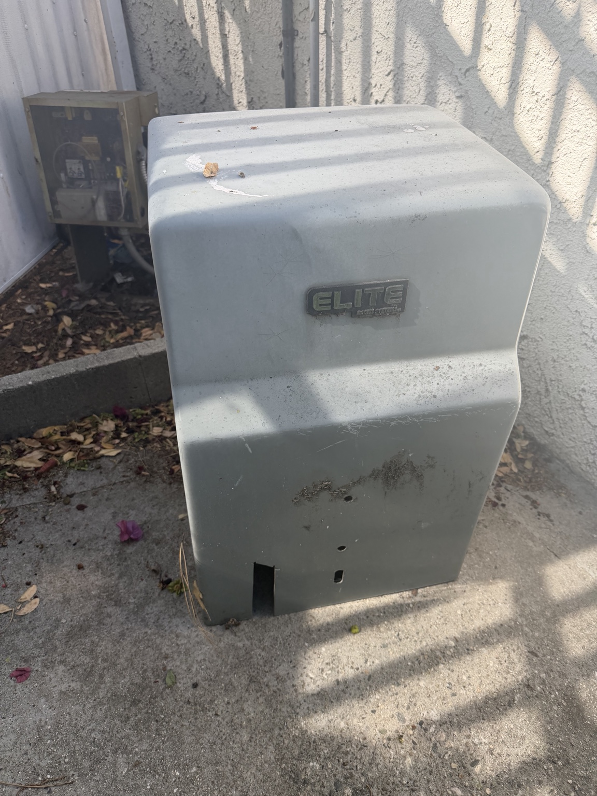
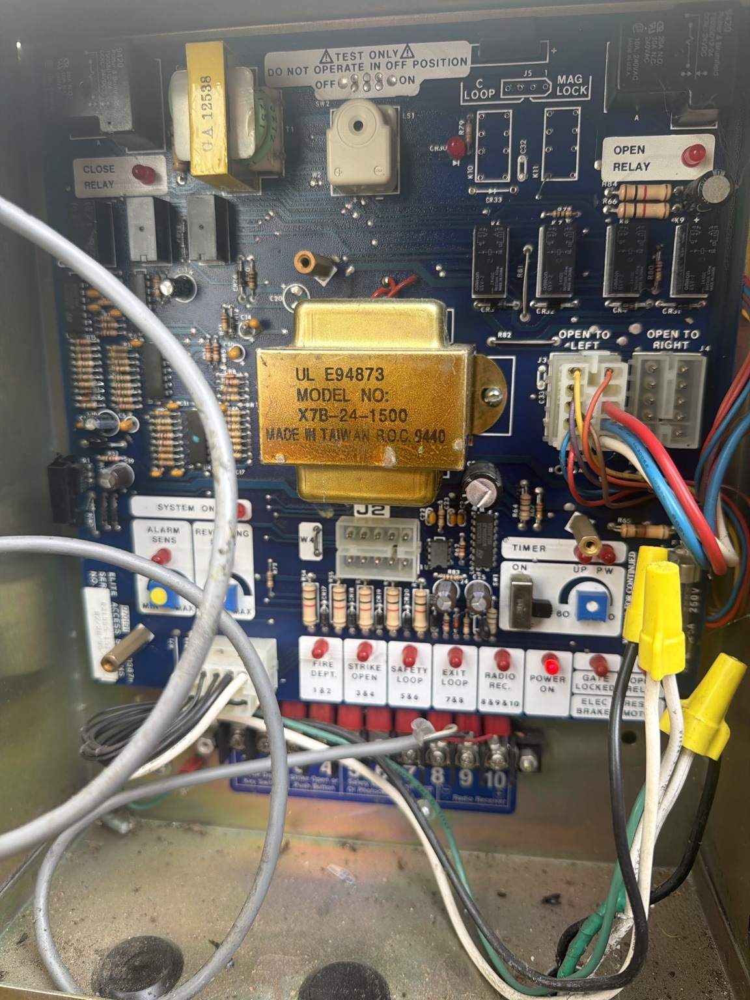

# A widget for my gate

*Gate Opener · Build notes by Daniel Yakobian · October 2026*

This started with wanting a button for my gate on my Mac and iPhone. It grew into
a small app that also shows whether the gate looks open or closed, the latest
camera picture, and a couple of rules for closing it when I forget.

Smart Life already controlled the gate, but I found the app buggy. I built this
around the hardware I already have. I'm sharing the source and these notes as a
record of how the pieces fit together.

[Read this on the website](https://danielyaa5.github.io/gate-opener-widget/) ·
[Technical setup](docs/SETUP.md)

## Starting with the hardware

I started with a broken, 30-year-old gate and an **Elite SL-3000 / SL-3000UL
sliding-gate operator**.
I kept that hardware and added an **Aubric Smart WiFi Garage Door Opener Remote
Controller**, a Tuya / Smart Life accessory sold for garage doors.
[This is the Amazon listing from my order](https://www.amazon.com/dp/B07QG7RGFW)
(ASIN `B07QG7RGFW`). That's a plain product link, not an affiliate link.

I connected the Aubric controller's two control wires directly to the gate's
control-board terminals. The approach is a normally-open dry-contact trigger:
a brief relay closure acts like pressing a button. The existing gate controller
still handles the motor and movement; the current software sends a half-second
pulse rather than holding the input on.

  
  &nbsp;
  

*The existing Elite operator and control board. The separate Aubric module is
not shown.*

The archived photos show the existing board, but don't verify which terminal
pair I used for the add-on. I'm leaving terminal numbers and supply voltage out
rather than turning these old photos into a wiring recipe. The gate's manual
and existing safety inputs still matter.

## Giving it a button on my devices

An always-on Mac runs a small Python bridge. The Mac and iPhone apps send it
signed requests over HTTPS, and the bridge talks to the Wi-Fi controller over
the home network. The controller's local key stays on that Mac.

The Mac desktop widget gives me a button without opening the app. The iPhone
has a Home Screen widget and a Control Center control. When I do open the Mac
app, I can check the camera and send a command from there. Closing its last
window removes the Dock icon; the widget and bridge keep running.

*The demo uses the app's real views with simulated camera images and states.
It doesn't show my gate or operate any hardware. [Watch the video](docs/images/demo.mp4).*

## A successful command wasn't enough

The relay can accept a command without telling me what the gate actually did.
That distinction became the next part of the project: showing the gate's
position separately from the last button press.

I started with a Ring doorbell, then switched to a continuously powered driveway
camera for more frequent snapshots. One lesson along the way was that a wired
doorbell can still be battery-based; a power wire doesn't necessarily make it
suitable for frequent image requests.

The comparison happens locally on the Mac. It crops the part of the picture
containing the gate and compares brightness-normalized structure and edges
against examples I labeled Open and Closed. Color and infrared images have
separate reference sets. Ring still supplies the pictures; there's no cloud
vision model deciding the position.

If the picture is old, unfamiliar or too close to both examples, the result is
Unclear. The app shows the picture's capture time and links to Ring Live View
so I can look for myself. The monitor checks about every ten seconds, though
Ring can delay images and iOS can delay widget refreshes.

  
  &nbsp;
  

## Letting it close the gate

Once I had a separate camera observation, I added an overnight rule for a gate
left open too long, and a distance rule using device observations from
TagTracker on the home Mac.

Both need fresh evidence that the gate is open before attempting a close. The
distance rule gets one attempt per trip and only resets after a confirmed return
home. Attempts are saved before sending, so restarting the service or losing a
response doesn't turn into repeated button presses. These rules are optional
and disabled in an unconfigured installation.

The camera is still an estimate, and a pulse can open, close or stop the gate
depending on its controller. The physical gate's obstruction sensors remain
responsible for safe movement. The implementation details and limits are in the
[automatic-closing notes](docs/AUTO_CLOSE.md) and [security policy](SECURITY.md).

## If you want to look around

The source includes the bridge, native SwiftUI apps and widgets, camera
comparison, and simulated-controller tests. It's specific to this setup;
another installation needs its own controller checks, wiring and calibration.

The signed [Mac download is version 1.0.0](https://github.com/danielyaa5/gate-opener-widget/releases/latest/download/GateOpener-mac.zip).
The camera pictures and automatic-closing features shown here are in the newer
source build. The iPhone app is built from source.

- [Build and setup notes](docs/SETUP.md)
- [Camera comparison and calibration](docs/CAMERA.md)
- [Automatic-closing rules](docs/AUTO_CLOSE.md)
- [Regenerate the screenshots and demo](docs/DEMO_MEDIA.md)
- [Changelog](CHANGELOG.md)

MIT licensed. Not affiliated with Aubric, Tuya, Smart Life, Ring or Amazon.
