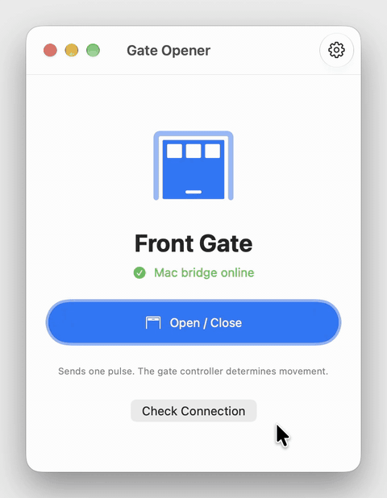
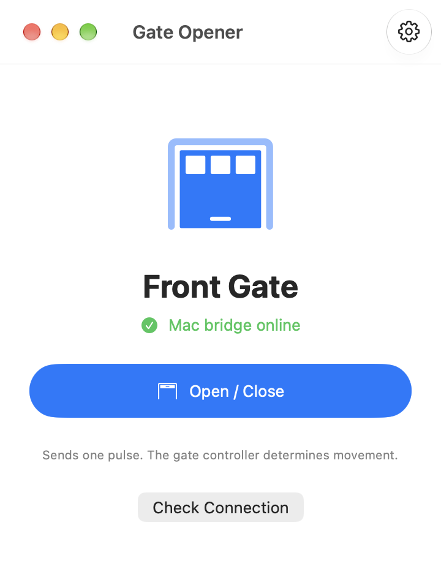
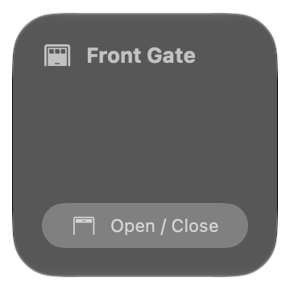

<p align="center"></p>

<h1 align="center">Gate Opener</h1>

<p align="center">Open a Tuya gate from a Mac desktop widget, an iPhone Home Screen widget or Control Center,
through a small bridge that runs on your own Mac.</p>

<p align="center">
  <a href="https://github.com/danielyaa5/gate-opener-widget/releases/latest/download/GateOpener-mac.zip"></a>
</p>

<p align="center">
  macOS 14 or later, signed and notarized · iPhone builds from source ·
  <a href="https://danielyaa5.github.io/gate-opener-widget/">Website</a>
</p>

<p align="center"></p>

<p align="center">
  
  &nbsp;&nbsp;
  
</p>

## How it works

- **A bridge on your Mac.** A small Python service on an always-on Mac talks to the gate
  controller over your LAN with its Tuya local key. The key never leaves that Mac.
- **Signed requests.** The apps sign every request with your own API secret, with a timestamp
  and a single-use nonce, and reach the bridge over HTTPS (for example with Tailscale Funnel).
- **One pulse, like a remote.** Open / Close sends one momentary pulse on Tuya data point 1.
  Your controller decides whether that opens, closes or stops the gate. The apps never know or
  guess the gate's position: a successful request means the controller accepted the pulse.

Works with Tuya-based momentary gate controllers that use data point 1. It is not a universal
gate driver; check your controller's data points and wiring before connecting it to a gate.

## Requirements

- An always-on Mac on the same LAN as the gate controller, with Python 3.10 or later.
- The controller's Tuya device ID and local key (a helper below can fetch them).
- macOS 14 or later for the Mac app and desktop widget; iOS 17 or later for the iPhone app.
- To build from source: Xcode 27.1 or later and XcodeGen (`brew install xcodegen`).

## Set up the bridge

From the project folder on the bridge Mac:

```sh
python3 -m venv .venv
.venv/bin/python -m pip install -r requirements.txt
cp .env.example .env
chmod 600 .env
```

Fill in the device ID, local key, controller IP and protocol version in `.env`. If you don't
have the local key yet, `.venv/bin/python scripts/setup_local_credentials.py` retrieves it with
your own Tuya cloud project credentials; it asks before replacing an existing `.env` and does
not save the cloud credentials. Reserve the controller's IP in your router.

Generate the API secret (an existing secret and your port, host and pulse settings are kept),
run the tests and install the service:

```sh
.venv/bin/python scripts/ensure_api_secret.py
.venv/bin/python -m unittest discover -s tests -v
.venv/bin/python scripts/install_launch_agent.py
curl http://127.0.0.1:8765/health
```

The LaunchAgent starts the bridge at login. On a dedicated server Mac you can instead run it
as a LaunchDaemon that starts at boot, and keep the Mac from sleeping:

```sh
sudo .venv/bin/python scripts/install_launch_daemon.py
sudo .venv/bin/python scripts/configure_server_power.py
```

Only use the power setting on a stationary, powered and ventilated Mac. Undo it with
`sudo pmset -a disablesleep 0`.

### Reach it from anywhere

Put the bridge behind HTTPS. [Tailscale Funnel](https://tailscale.com/docs/features/tailscale-funnel)
gives it a stable `https://…ts.net` address without the phone needing a VPN app:

```sh
brew install --formula tailscale
sudo brew services start tailscale
sudo tailscale up
sudo tailscale funnel --bg 8765
curl https://your-mac.your-tailnet.ts.net/health
```

Never forward the bridge's port through your router.

Optionally install the Funnel watchdog. Once a minute it checks the local and public health
endpoints and, if only the public one keeps failing, refreshes Tailscale and restores the Funnel
mapping, with a cooldown so it can't loop. (It also restarts a stuck `NordVPN NordLynx`
connection if one exists.)

```sh
sudo .venv/bin/python scripts/install_funnel_watchdog.py --public-url https://your-mac.your-tailnet.ts.net
```

## Connect the apps

The apps contain no bridge address or secret. Each device is connected with a setup code that
holds your bridge URL and API secret. On the bridge Mac:

```sh
.venv/bin/python scripts/setup_code.py --url https://your-mac.your-tailnet.ts.net
```

Copy the `gate1:…` code it prints. In Gate Opener's **Bridge** screen (shown on first launch, or
from the gear button), click **Paste**. The app saves the connection in the Keychain and shares
it with its widget. You can also type the URL and secret by hand under **Or enter manually**.

The setup code contains your API secret: paste it only on your own devices and never post it.
Without `--url`, the code points at the Mac's local `.local` address, which only works at home.

### Mac

1. [Download GateOpener-mac.zip](https://github.com/danielyaa5/gate-opener-widget/releases/latest/download/GateOpener-mac.zip),
   unzip it and move **Gate Opener** to Applications.
2. Open it, paste the setup code, and click **Check Connection**.
3. Right-click the desktop, choose **Edit Widgets**, search for Gate Opener and add the widget.

The app asks for confirmation before it sends a pulse. The widget sends it on one click. The
Mac app and widget talk to the bridge directly and don't need an iPhone.

### iPhone (build from source)

There is no App Store build. Build and install it with your own Apple Developer team and a
reverse-DNS prefix you control (it names the bundle IDs and the app group the widget shares):

```sh
xcodegen generate --spec ios/project.yml
xcodebuild -project ios/GateOpener.xcodeproj -scheme GateOpener -configuration Release \
  -destination generic/platform=iOS -derivedDataPath ios/DerivedData -allowProvisioningUpdates \
  DEVELOPMENT_TEAM=YOURTEAMID GATE_BUNDLE_PREFIX=com.yourname
xcrun devicectl device install app --device "Your iPhone" \
  "ios/DerivedData/Build/Products/Release-iphoneos/Gate Opener.app"
```

Or open `ios/GateOpener.xcodeproj` in Xcode, set your team and `GATE_BUNDLE_PREFIX` for both
targets, and run on your phone. A paid developer membership is recommended: apps signed by a
free personal team stop launching after seven days. Then paste the setup code in the app.

The app includes a Home Screen widget and, on iOS 18, a Lock Screen and Control Center control.
**That control works without unlocking the phone**, so anyone holding the phone can use it.
Leave it off if that doesn't suit you.

### Mac from source

```sh
xcodegen generate --spec macos/project.yml
open macos/GateOpenerMac.xcodeproj
```

Set your team and `GATE_BUNDLE_PREFIX` for both targets and run on My Mac. To build a signed,
notarized download like the one on the releases page:
`TEAM_ID=YOURTEAMID BUNDLE_PREFIX=com.yourname macos/release.sh 1.0.0`.

## Try it without a gate

`scripts/demo_bridge.py` runs a bridge with a simulated gate on `127.0.0.1:8799`. Open / Close
only waits a moment and logs a pulse; nothing talks to a controller. It prints a setup code with a
public demo secret, so it only listens on localhost.

```sh
.venv/bin/python scripts/demo_bridge.py
```

Paste that code into the Mac app to try the app and widget. Paste your real code again afterwards.

## Alexa (optional)

`alexa_skill/` is a private Alexa custom skill for AWS Lambda that sends the same signed pulse
("Alexa, open front gate"). It isn't published to the skill store; it only works on Echo devices
on the Amazon account that owns the skill. An Alexa Routine can give it a shorter phrase.

- It signs with its own secret, `GATE_ALEXA_API_SECRET` in `.env`, sent with the
  `X-Gate-Client: alexa` header. Remove that secret and restart the bridge to cut off voice access.
- The Lambda accepts only its own skill ID, optionally only listed Alexa user IDs, and only fresh
  requests. Each request carries an idempotency key; the bridge refuses a repeat for ten minutes.
- It makes one attempt and never retries after a timeout.
- **There is no voice PIN.** Anyone whose voice reaches an enrolled Echo can trigger the gate.

| Lambda setting | Value |
| --- | --- |
| Runtime | Python 3.12 or later, handler `lambda_function.lambda_handler` |
| Timeout | 10 seconds |
| Trigger | Alexa Skills Kit, restricted to the skill ID |
| `GATE_BRIDGE_URL` | Your public bridge URL, without a path |
| `GATE_ALEXA_API_SECRET` | Same value as in the bridge's `.env` |
| `ALEXA_SKILL_ID` | The skill's `amzn1.ask.skill…` ID |
| `ALEXA_ALLOWED_USER_IDS` | Optional, comma-separated Alexa user IDs |

The interaction model is `alexa_skill/interaction_model.json`.

## Safety

- The apps send a pulse; they don't see the gate. Keep the gate's own safety sensors working,
  and only test with someone watching the gate.
- Depending on the controller, a pulse can open, close or stop the gate.
- A timeout can happen after the controller already accepted a pulse, so nothing retries an
  ambiguous request automatically. The bridge also enforces a cooldown between pulses.
- Treat the API secret like a key to the gate. If a setup code or `.env` leaks, clear the value of
  `GATE_API_SECRET` in `.env`, run `scripts/ensure_api_secret.py`, restart the bridge, and paste
  a new setup code on each device.
- The automated tests use simulated controllers and never touch hardware.

## Troubleshooting

| Symptom | Check |
| --- | --- |
| Local `/health` fails | Check the service with `launchctl print gui/$(id -u)/com.danielyakobian.gate-bridge` and read `~/Library/Logs/gate-bridge.error.log`. |
| Health works but the app fails | `/health` is unauthenticated and doesn't check the controller. Paste a fresh setup code, then click Check Connection. |
| Controller unreachable | Confirm the reserved IP, local key, protocol version and LAN access. A VPN on the bridge Mac must allow local network traffic. |
| Signature rejected | The app and bridge must share the same API secret, and both clocks must be accurate. |
| Mac widget missing | Open the app from Applications once, then look again in Edit Widgets. |
| Accepted but nothing moved | Check controller compatibility, relay wiring and the gate itself. An accepted command doesn't prove movement. |

Logs can contain operational details; review them before sharing and never post `.env` or a
setup code. App diagnostics are uploaded with signed requests to
`~/Library/Logs/gate-bridge.client.log`, which rotates.

To update the bridge, pull the new source, reinstall requirements, run the tests and rerun
`scripts/install_launch_agent.py`. To remove it:

```sh
launchctl bootout "gui/$(id -u)/com.danielyakobian.gate-bridge"
rm "$HOME/Library/LaunchAgents/com.danielyakobian.gate-bridge.plist"
```

Turn off the Funnel with `sudo tailscale funnel --https=443 off` if you set one up.

## Contributing and license

MIT licensed. See [CONTRIBUTING.md](CONTRIBUTING.md), [SECURITY.md](SECURITY.md) and
[CHANGELOG.md](CHANGELOG.md). GitHub Actions runs the bridge tests and checks the source package;
Apple builds are checked locally with `scripts/validate_release.py --apple-builds`.

The app icon artwork was made with OpenAI image generation; the master image is
`assets/gate-icon-master.png`. Not affiliated with Tuya, Smart Life, Tailscale or Amazon.
